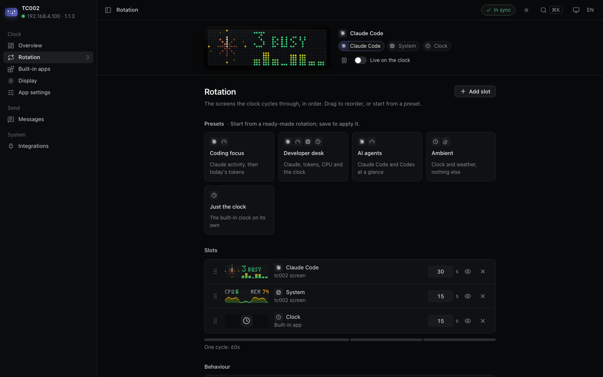
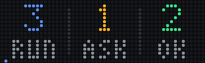
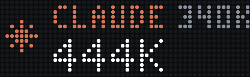
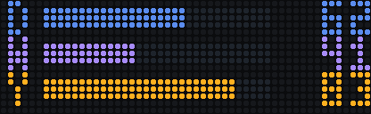
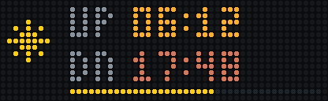

# tc002

Set up and run your **Ulanzi TC002** pixel clock (52×16 RGB) from your Mac: brightness
and sound, time and date, which built-in apps stay on and how long each shows, messages,
and live screens of your own. It talks to the clock's stock firmware over your local
network — no flashing, no account, no cloud, no runtime dependencies beyond Python.

```bash
uv tool install git+https://github.com/Misoto22/tc002
tc002 ui            # opens http://127.0.0.1:8742 and walks you through setup
```

## What you can do

- **Get started in four steps** — `tc002 ui` finds the clock on your network, saves a
  settings file, offers a starting layout and, if you use them, connects Claude Code and
  Codex. Everything can be changed later.
- **Display & sound** — brightness (three levels, each with its own percentage), volume,
  time zone, date format, week start, scroll speed. The quick settings in the top bar
  apply brightness and volume at once.
- **Built-in apps** — keep the ones you want (clock, weather, Pomodoro, social counters,
  calendars…), turn the rest off, and set their options: clock format, weather city
  (search by name), focus timer lengths. Accounts and API keys stay in Ulanzi Studio.
- **Rotation** — the order and duration of everything the clock shows, replacing the
  device's own carousel. Drag to reorder, start from a preset, and try a change **live on
  the clock** before saving.
- **Messages** — send text or an alert in English or Chinese from the UI, the command
  line, or any script or CI job on the same network.
- **Screens** — tc002 adds its own animated screens to the rotation (see the gallery
  below), rendered on your Mac and sent as looping GIFs.

The interface is in English or Chinese, light or dark, in five colour themes, with ⌘K for
anything and ⌘S to save.



## Requirements

- A TC002 on stock firmware **V1.1.0 or later**, on the same 2.4 GHz network as your Mac
  (`tc002 doctor` checks; update the firmware in Ulanzi Studio if needed).
- macOS — the background service uses launchd, and some screens read macOS tools.
- [uv](https://docs.astral.sh/uv/), which installs the right Python for you.

## Install

```bash
uv tool install git+https://github.com/Misoto22/tc002
tc002 ui
```

The first page finds the clock and creates your settings in `~/.config/tc002/tc002.toml`.
From the command line instead:

```bash
tc002 setup --host 192.168.1.50   # the clock's address: Ulanzi Studio or your router lists it
tc002 install                     # apply the layout, start the background service
tc002 doctor
```

| Step of `tc002 install` | On its own | Undo |
|---|---|---|
| Keep only the built-in apps you chose; hand the carousel to tc002's rotation | `tc002 layout apply` | `tc002 layout restore` |
| Start the background service (at login, restarted if it stops) | `tc002 service install` | `tc002 service uninstall` |
| Connect Claude Code, if you use it (hooks and status line; your own settings are kept, a backup is written first) | `tc002 hooks install` | `tc002 hooks uninstall` |

`tc002 uninstall` undoes all three and puts the clock's own apps back.

## Screen gallery

Screens tc002 draws itself, each exactly 52×16 pixels. Turn them on in **Rotation**.

| Sessions | Waiting for you | Finished | Plan limits |
|---|---|---|---|
|  |  |  |  |

| System | Text | Alert | Limits, one unknown |
|---|---|---|---|
|  |  |  |  |

| Focus timer | Day progress | Countdown | World clock |
|---|---|---|---|
|  |  |  |  |

| Sunrise & sunset | Moon | Game of Life | Fireplace |
|---|---|---|---|
|  |  |  |  |

- **Sessions** (for Claude Code users) — how many sessions are running, asking for you,
  and finished but unread. A session that starts waiting takes over the clock with its
  project name until you answer.
- **Plan limits** (for Claude Code and Codex users) — one row per agent: the 5-hour
  allowance used as a number and a bar, the 7-day allowance as a line under it; amber from
  80 %, blinking from 95 %.
- **System** — a scrolling CPU chart of the last 52 seconds, plus memory.
- **Focus timer** — work, then a break, counting down by the second; start it from the
  Overview or `tc002 focus start`.
- **Day progress, Countdown, World clock** — how much of the day, week and year has gone;
  days to a date you name; the time in two places.
- **Sunrise & sunset, Moon** — today's daylight where your weather city is, and the
  moon's phase.
- **Game of Life, Fireplace** — calm animations for between the busy screens.

Screens with options (the countdown's date, the world clock's places, the focus timer's
lengths) are set in **App settings**.

Nothing a screen reads leaves your Mac.

## Command line

```text
tc002 ui                             settings in the browser (local only)
tc002 doctor                         check settings, clock, firmware, service, hooks
tc002 text "BUILD OK" --color green  short text shimmers; long text scrolls, then clears
tc002 text "构建完成" --show          ...in Chinese, and switch the clock to it
tc002 alert "DEPLOYED" --kind done   chasing-lights alert, removed after 10 s
tc002 alert "PROD DOWN" --kind error --keep
tc002 layout show                    built-in apps now on, carousel setting
tc002 apps / tc002 rm [app...]       list / remove custom apps on the clock
tc002 info                           firmware, Wi-Fi, brightness
tc002 watch                          run screens and rotation in the foreground
tc002 --preview out/ watch --once    write LED mock-up GIFs instead of touching the clock
```

Every command has `--help`. Colours: `white green yellow red blue orange cyan` or
`#RRGGBB`. Text may be English or Chinese; characters the clock's fonts lack show as `?`.

From a script or CI step on the same network:

```bash
tc002 alert "TESTS GREEN" --kind done || true
```

## Configure

`tc002 ui` writes everything to one file, `~/.config/tc002/tc002.toml`, then applies it to
the clock; you can also edit the file and run `tc002 layout apply`.
[`tc002.example.toml`](tc002.example.toml) describes every option. In short:

```toml
[screens]
enabled = ["sys"]

[device]
keep_builtins = ["clock", "weather"]   # every other built-in app is turned off

[display]                              # optional: clock-wide settings
volume = 2
timezone = "UTC+1"
brightness = { level = "mid" }

[apps.weather]                         # optional: built-in app settings (never credentials)
city = "Berlin"

[rotation]
slots = [
  { builtin = "clock", seconds = 30 },
  { screen = "sys", seconds = 15 },
  { builtin = "weather", seconds = 15 },
]
```

An empty `slots` list leaves the device's own carousel in charge.

## How it works

```text
tc002.toml ─► config ─► watcher ─┬─ screen threads ── sample → render → Output ─► POST /api/custom
                                 └─ rotation ─────── switchDiyApp / switchApp ──► clock
tc002 ui ─► local server (127.0.0.1 only, per-session token) ─► tc002.toml ─► clock, service
```

[docs/architecture.md](docs/architecture.md) has the module map,
[docs/decisions.md](docs/decisions.md) why it is built this way, and
[docs/device-notes.md](docs/device-notes.md) what the firmware actually does.

## Troubleshooting

| Symptom | Cause and fix |
|---|---|
| The clock is not found | It must be on the same 2.4 GHz network as the Mac, not a guest network with client isolation. Enter its address by hand on the first page. |
| Every request times out, but `curl http://<ip>/getBase` works | A proxy in `HTTP_PROXY` — tc002 already bypasses it; other tools need the clock's IP in `NO_PROXY`. |
| Log shows `No route to host` | macOS Local Network permission for uv's Python: System Settings → Privacy & Security → Local Network. |
| Screens never appear | No rotation is set and the clock is not on its DIY page — add slots, or press the knob to DIY. |
| `doctor` says to update the firmware | Firmware before V1.1.0 cannot switch screens remotely; update in Ulanzi Studio. |
| Clock unplugged | The service keeps retrying quietly and re-sends everything when it is back. |

Log: `~/Library/Logs/tc002.log`.

## Development

```bash
git clone https://github.com/Misoto22/tc002 && cd tc002
uv sync
uv run pytest
uv run ruff check . && uv run ruff format --check .
uv run python scripts/render_docs.py       # refresh docs/screens/*.gif
uv run python scripts/vendor_icons.py      # refresh the icon sprite
uv run python scripts/vendor_fonts.py      # refresh the UI fonts
uv run python scripts/vendor_cjk_font.py   # refresh the clock's Chinese font
```

Commits and pull-request titles follow [Conventional Commits](https://www.conventionalcommits.org/);
releases and `CHANGELOG.md` come from release-please.

## License

[MIT](LICENSE). Fonts: Inter Tight and DM Mono (SIL OFL 1.1) in the UI, Fusion Pixel Font
(SIL OFL 1.1) on the clock. Not affiliated with Ulanzi.
